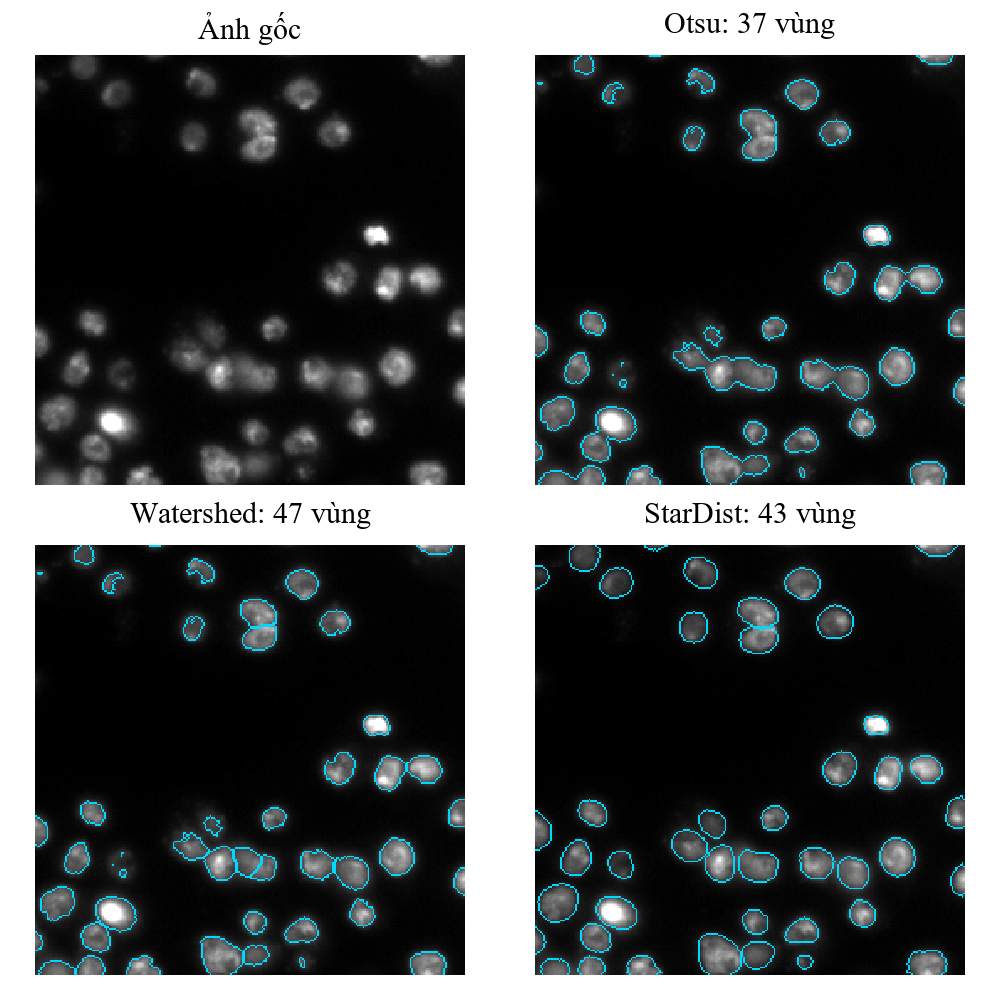

# Phân đoạn từng đối tượng bằng StarDist

Bài tập lớn môn Xử lý ảnh, nhóm 3. Dự án phân đoạn từng nhân trên ảnh hiển vi 2D, so sánh StarDist với Otsu và Watershed, đồng thời dùng Fiji/ImageJ làm nền tảng tham chiếu.

| Thành viên | Mã sinh viên |
|---|---|
| Nguyễn Văn Hiển | B23DCCN290 |
| Mai Anh Hoàng | B23DCCN332 |
| Trần Quang Huy | B23DCCN409 |
| Bùi Minh Ngọc | B23DCCN604 |

Giảng viên hướng dẫn: Nguyễn Tất Thắng.

## Chạy demo một ảnh

Môi trường đã kiểm tra: Windows 64-bit, Python 3.13.6, TensorFlow 2.20.0 chạy CPU. `requirements.txt` ghi các thư viện sử dụng, `requirements-lock.txt` lưu phiên bản của máy thực nghiệm.

Trong PowerShell:

```powershell
git clone https://github.com/nguyenhien18/XLA_BTL.git
cd XLA_BTL
python -m venv .venv
.\.venv\Scripts\python.exe -m pip install -r requirements.txt
.\.venv\Scripts\python.exe scripts\setup_demo_data.py
.\.venv\Scripts\python.exe scripts\download_model.py
.\.venv\Scripts\python.exe src\demo_image.py --image data\prepared\images\img_0320.png
```

Cửa sổ demo hiển thị ảnh gốc và kết quả chạy mới Otsu, Watershed, StarDist. Nhãn chuẩn không tham gia dự đoán. Các kết quả của mỗi lượt chạy nằm riêng trong `results/live_demo/`. Dùng `--no-show` để lưu kết quả mà không mở cửa sổ.

Repo kèm **10 cặp ảnh và nhãn demo** trong `data/demo/`. `setup_demo_data.py` kiểm tra SHA-256 và chép chúng sang `data/prepared/`, không ghi đè tệp khác nội dung. Đây chỉ là tập con test để demo, không đủ để huấn luyện hoặc tái chạy toàn bộ benchmark.

Trọng số pretrained và toàn bộ dữ liệu không nằm trong Git. `download_model.py` tải mô hình chính thức và kiểm tra checksum đã chốt tại `models/2D_versatile_fluo_source.json`.

## Phạm vi cài đặt

| Thành phần | Cách thực hiện |
|---|---|
| Otsu | Tự tính histogram, phương sai giữa hai lớp và tìm ngưỡng. Gán nhãn/lọc diện tích bằng thư viện. |
| Watershed | Xây dựng quy trình foreground, bản đồ khoảng cách và hạt giống bằng SciPy/scikit-image. |
| CNN của StarDist | Sử dụng mô hình từ StarDist/TensorFlow. |
| Dựng đa giác và NMS | Tự viết tọa độ tia, sắp theo score, loại dự đoán trùng và gán nhãn. Dùng pyclipper để tính giao, skimage để tô đa giác. |
| Huấn luyện | Fine-tune từ pretrained, chọn checkpoint theo validation loss. |

CNN và cơ chế tính gradient dùng thư viện. Nhóm không tuyên bố tự viết toàn bộ mạng CNN từ đầu.

## Chạy hàng loạt và đánh giá demo

Sau các bước chuẩn bị demo ở trên:

```powershell
.\scripts\run_python_demo.ps1
```

Script chạy ba phương pháp Python, đánh giá theo nhãn chuẩn và tạo hình so sánh. Khi đã có đủ nhãn Fiji trong `results/stardist_fiji/`, script đánh giá thêm phương pháp này. Các lần chạy lại chỉ bỏ qua đầu ra có đúng cấu hình và provenance. Chỉ dùng `-Overwrite` khi chủ động thay kết quả dự đoán.

Kiểm thử:

```powershell
.\.venv\Scripts\python.exe -B -m unittest discover -s tests -v
```

## Chuẩn bị toàn bộ dữ liệu

Nguồn: [BBBC038v1 / 2018 Data Science Bowl](https://bbbc.broadinstitute.org/BBBC038). Ảnh và mask do nguồn cung cấp; nhóm chuyển định dạng và gán ID, không tự chụp hay tự vẽ lại toàn bộ nhãn.

**Chọn chế độ này trên bản clone chưa chạy `setup_demo_data.py`.** Script chuẩn bị từ chối ghi đè nếu `data/prepared/images` đã có ảnh. Nếu đã chuẩn bị demo, dùng một bản clone khác để làm thực nghiệm đầy đủ.

```powershell
.\.venv\Scripts\python.exe scripts\download_dataset.py
.\.venv\Scripts\python.exe scripts\prepare_dataset.py
.\.venv\Scripts\python.exe scripts\verify_dataset.py
.\.venv\Scripts\python.exe scripts\download_model.py
```

Từ 670 ảnh có nhãn, nhóm chọn 545 ảnh xám có nhân sáng trên nền tối. Chia cố định 381 train, 82 validation, 82 test. Tập demo gồm 10 ảnh thuộc test. Xem [quy trình dữ liệu](docs/DU_LIEU.md).

Sau khi có đầy đủ dữ liệu:

```powershell
.\scripts\run_test_experiments.ps1
.\.venv\Scripts\python.exe src\check_custom_postprocess.py --split test
.\.venv\Scripts\python.exe src\finetune_stardist.py
.\.venv\Scripts\python.exe src\evaluate_finetuned.py
```

Fine-tune lưu vào tên mô hình trong `configs/finetune.json` và từ chối ghi đè lần học cũ. Nếu chạy thêm thí nghiệm, đổi `model_name`. Repo lưu lịch sử và kết quả của lần đã báo cáo tại `experiments/recorded_run/finetune/`, không kèm checkpoint fine-tuned. Muốn đánh giá lại checkpoint trên máy mới cần huấn luyện hoặc tự chuyển checkpoint đã có sang `models/stardist_finetuned_v1/`.

## Fiji/ImageJ

1. Cài Fiji và bật các update site StarDist, CSBDeep, TensorFlow theo [hướng dẫn chính thức](https://imagej.net/plugins/stardist).
2. Trong hai script Groovy ở `fiji/macros`, sửa biến `root` từ đường dẫn máy thực nghiệm sang đường dẫn bản clone của bạn.
3. Mở `batch_stardist_demo.groovy` bằng Fiji Script Editor, chọn Groovy rồi Run để tạo TIFF 16-bit và ROI ZIP cho 10 ảnh.
4. Chạy `evaluate_demo.groovy` để tính chỉ số trong Fiji. Sau đó chạy lại `run_python_demo.ps1` để đối chiếu Python.

Cấu hình baseline: mô hình Versatile (fluorescent nuclei), phân vị 1/99,8, score 0,48, NMS 0,30, Boundary Exclusion 0. Xem thêm [tài liệu Fiji](fiji/README.md).

## Kết quả đã thực hiện

Các tệp trong `experiments/recorded_run/` là kết quả lưu từ lần thực nghiệm của báo cáo. Chúng tách khỏi `results/` để không nhầm với đầu ra vừa chạy trên máy mới.

| Phương pháp | F1 ban đầu | F1 sau điều chỉnh tham số | Thời gian CPU trung bình (ms/ảnh) |
|---|---:|---:|---:|
| Otsu | 0,5882 | 0,6598 | 2,291 |
| Watershed | 0,6441 | 0,7302 | 15,954 |
| StarDist pretrained | 0,9283 | 0,9309 | 135,623 |

Đánh giá trên cùng 82 ảnh test, 3.852 nhân chuẩn, ghép một-một tại IoU ≥ 0,5. Tham số điều chỉnh được chọn trên validation. Thời gian CPU loại phần đọc ảnh/tải mô hình/tính metric, có warm-up và 5 lần đo mỗi ảnh. Thời gian của StarDist trong bảng dùng hậu xử lý thư viện.

Fine-tune chạy 16 epoch, chọn epoch 11 theo validation loss. Với cùng score 0,55 và NMS 0,30, F1 test giảm từ 0,9309 xuống 0,9216. **Không kết luận fine-tune cải thiện chất lượng.**

Giới hạn: pretrained có thể đã học một phần DSB2018. Chia tập mới chỉ bảo đảm ID trong dự án không trùng nhau, chưa chứng minh test độc lập với dữ liệu huấn luyện gốc.



## Cấu trúc chính

```text
src/                         thuật toán, demo, đánh giá, khảo sát và benchmark
scripts/                     chuẩn bị dữ liệu, tải mô hình và lệnh chạy
configs/                     cấu hình baseline, optimized, fine-tune
data/demo/                   10 cặp ảnh/nhãn mẫu và checksum
data/splits/                 danh sách train/val/test/demo đã chốt
fiji/macros/                 chạy batch và đánh giá bằng Groovy
tests/                       kiểm tra hành vi Otsu và Watershed
docs/                        giải thích dữ liệu, phương pháp và thực nghiệm
experiments/recorded_run/    số liệu, lịch sử học và hình của lần đã báo cáo
```

Một số tài liệu thực nghiệm ghi đường dẫn `D:\BTL_XLA` hoặc `results/...` của máy chạy ban đầu. Trên máy mới, dùng đường dẫn bản clone; kết quả lưu sẵn để đối chiếu nằm trong `experiments/recorded_run/`.

## Tài liệu nguồn

- Schmidt và cộng sự. [Cell Detection with Star-convex Polygons](https://arxiv.org/abs/1806.03535), MICCAI 2018.
- Ronneberger và cộng sự. [U-Net](https://arxiv.org/abs/1505.04597), MICCAI 2015.
- [Mã nguồn StarDist](https://github.com/stardist/stardist), [mô hình pretrained](https://github.com/stardist/stardist-models).
- [BBBC038v1](https://bbbc.broadinstitute.org/BBBC038). Nguồn và checksum ảnh trong `docs/DU_LIEU.md`.

Báo cáo Word và slide nộp riêng. Repo này tập trung vào mã nguồn và cách tái chạy.
